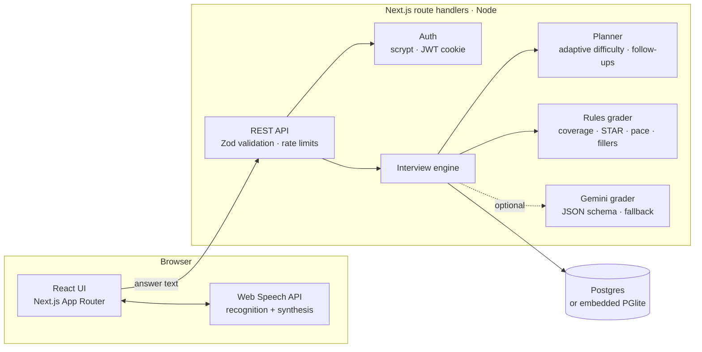

<p align="center">
  
</p>

# Rehearse · AI mock interviews

**[Live demo →](https://ai-mock-interviews-v2-gules.vercel.app)** · no sign-up

**The problem.** Most people prepare for interviews by reading answers, then freeze when they have to say them out loud to someone who is judging them. Friends go easy on you; question banks never talk back.

**Who it's for.** Students and engineers preparing for technical and behavioural interviews (13 roles, intern to senior) who want honest practice on demand.

**Why it's different.**
- **It's a conversation, not a quiz.** Arjun, the interviewer, speaks, waits until you have finished (no buttons), digs into what you actually said, and ends with "Do you have any questions for me?"
- **It measures how you sound, not just what you said.** Pitch variety, pauses and pace come from the raw microphone signal (YIN pitch tracker, validated against Praat to within 1 Hz on synthesised speech), and eye contact from on-device face tracking. No audio or video leaves your browser.
- **It gives you the panel's call.** The report says Strong hire to No hire against the bar for your level, and your practice log plots every interview against that bar.
- **It works with zero setup.** No API key or database needed: an embedded Postgres and a rules grader run out of the box; Gemini is optional and falls back to the rules on any failure.

**Measured numbers** (production build on a 4-core sandbox, Chromium, median of 5 loads; API over 50 answers, rules grader):

| | |
| --- | --- |
| Home page | FCP 140 ms, 140.8 KB of JavaScript transferred (compressed) |
| Practice log | FCP 104 ms, 111.3 KB of JavaScript |
| Answer endpoint | p50 9 ms, p95 15 ms (AI grading runs after the reply) |
| Tests | 91 unit (Vitest), 9 end-to-end (Playwright) |
| `npm audit --omit=dev` | 0 vulnerabilities |

Practise job interviews **out loud**. Rehearse reads each question, listens to your spoken answer, asks follow-ups when you miss something important, and gives you a detailed report with scores for **content, depth, structure and delivery**.

This is version 2, a complete rebuild of an earlier AI mock interview platform.


## Highlights

- **Listens and adapts like a person.** After each answer a small, fast AI call (Flash-Lite, 5 s limit) decides what Arjun says and does next: he reacts to something specific you said or to how you came across (rushing, flat voice, avoiding eye contact, lying down), digs deeper with his own follow-up built on your words (up to twice on the same question), or picks the next topic that follows from the conversation and bridges to it. Full grading runs in the background after the reply has gone back, so the conversation never waits on it.
- **His verdict, to your face.** After answering your closing question he says "Before you go, I'll give you my honest feedback" and tells you, out loud and without sugar-coating, whether you'd get through, your weakest moment in your own words, and the one thing to fix. The written report follows. Without AI, a rules-based verdict is just as blunt.
- **Runs like a real interview, start to finish.** Arjun introduces himself and his team, says how long it will take, asks his questions with follow-ups, and ends with "Do you have any questions for me?", answering yours in character. During the call he keeps his verdict to himself, like a real interviewer: no scores on screen, just natural acknowledgements, though he will stop you on the spot over conduct (lying in bed, joking). Say "let me think" and he waits; run past three minutes and he politely cuts in.
- **A hiring panel's decision, not just a score.** The report opens with the call a real panel would make (Strong hire, Hire, Lean hire, Lean no hire or No hire) against the bar for your level, with the reasons. Conduct problems or skipped questions cap the call however good the rest was. The AI grades against a level-specific rubric with fixed score anchors, so marks are not inflated, and your closing question is judged too (asking nothing, or leading with salary, is called out).
- **A home page made of the real instruments.** No marketing cards: the landing page runs the product's own code live. A voice is drawn on graph paper by the same YIN pitch tracker that measures answers (press one button to see your own), with every pause over 0.6 s bracketed in red pencil. Below it, a slider shows exactly when the turn-taking rule (`decideTurn`) lets the interviewer reply, buttons feed answers into the Bayesian skill estimate so you can watch its range tighten, and a text box runs the red-flag check as you type. Graph paper by day, blueprint by night.
- **A real conversation, hands-free.** No answer or send buttons: the interviewer asks, the microphone opens, and an end-of-turn detector (silence measured from the audio and from new words, with more patience for short answers) decides when you have finished. "That's it" ends a turn early; "can you repeat the question?" gets the question again instead of a grade; a long silence gets one gentle nudge. He reacts to what you actually said, then moves on or digs in.
- **Brutally honest, like a real hiring manager.** Gemini plays a senior interviewer who says when an answer would not pass, quotes what you said, and flags red flags (an unprofessional setting, a non-answer, a dismissive tone). Without AI, a rules engine catches the same red flags and caps the score. Uses current Gemini models with automatic fallback (`gemini-3.8-flash`, then `gemini-3.5-flash-lite`), because new API keys can no longer use 2.5 Flash.
- **Feels like a real video call.** A Meet-style room with a lobby (camera preview), an interviewer who talks on screen (his mouth follows the loudness of his voice), your camera tile, live captions, a call clock, and just two controls, camera and leave. It is voice only, like a real interview: no typing, no repeat button (ask him out loud), and one take per answer. The interviewer acknowledges each answer ("Okay, thanks.") and leads into follow-ups the way a person would.
- **A natural interviewer voice.** With a Gemini key, questions are spoken by Gemini text-to-speech (`gemini-3.8-flash-tts`, voice "Achird"), fetched ahead of time so there is no gap, and cached. Without a key, or if the call fails, the browser's best voice takes over automatically.
- **Watched like a real interviewer would.** While you answer, the camera feed is checked live: lying down or slumped sideways (head roll), leaving the frame, or looking away for a long stretch. You see an alert on your own tile straight away, and if it lasts, Arjun pauses listening, says it out loud ("It looks like you're lying down. Could you sit up and face the camera?") and carries on with the same answer. Lying down or being off camera also counts as a red flag in the grading and the hiring decision. If your camera is off when the call starts, he asks you to turn it on.
- **No dead air.** He says "Okay." the moment you finish while your answer is graded, his fixed lines are loaded before you join, the microphone stays open for the whole call, a slow natural voice falls back to the browser's after 4.5 seconds, and AI grading gives up after 9 seconds in favour of the rules grader.
- **Video analysis on your device.** With the camera on, face tracking runs in the browser (Human / TensorFlow.js on WebGL, models served by this site, nothing uploaded): eye contact from head pose and gaze, look-aways, smiling, head movement, framing and lighting, all turned into feedback and a report section. Checked in Chromium with a fake webcam showing a public-domain portrait: the face was found whenever it was in view and never in empty frames, read as looking at the camera, and its smile detected.
- **Voice first, no paid voice API.** Speech recognition and the interviewer's voice run in the browser (Web Speech API). Audio never leaves your device; only the final text is sent. Voice only, so it needs Chrome or Edge on a computer.
- **Adaptive interviewer.** Difficulty moves up after strong answers and down after weak ones. If you miss a key concept, the interviewer probes it with a follow-up, as a real one would.
- **Measured, not guessed, delivery.** Speaking pace, filler words ("um", "basically", "like" as a filler but not as a verb) and hedging are computed from your answer.
- **Voice analytics from the audio itself.** While you answer, the browser analyses the raw microphone signal (an AudioWorklet feeds every sample, gap-free, to a from-scratch DSP pipeline):
  - **pitch** with the YIN estimator (de Cheveigné & Kawahara, 2002), summarised as variety in semitones, so a flat, monotone answer is flagged with a concrete tip;
  - **pauses** from voice-activity detection with an adaptive noise floor: how many, how long, and the share of silent time, so pace is computed from real speaking time;
  - **loudness steadiness** in dB.

  Validated against Praat (the phonetics standard) on synthesised speech: median pitch within 1 Hz and pitch variety within 0.1 semitones for male and female voices, with inserted 2.2 s pauses measured as 2.3 s. Only the summary numbers are sent; no audio leaves the device.
- **A skill map that learns.** Every answer updates a Bayesian estimate of how well you know each topic (a Beta posterior, with harder questions counting for more and old answers fading over a 30-day half-life). The dashboard shows each topic with an uncertainty band, so one lucky answer never marks a topic as mastered. A spaced-practice schedule brings weak topics back after a day and strong ones after ten, and **"Practise my weak spots"** starts a session aimed straight at them.
- **STAR coaching** for behavioural questions: situation, task, action and result are checked, and missing parts are named.
- **Two grading engines behind one interface.**
  - Rules: transparent, deterministic scoring that works with zero configuration.
  - AI (Gemini): grades content, depth and structure with a JSON schema and validates the response with Zod. Delivery stays measured. If the AI call fails or times out, it falls back to the rules engine, so a session never breaks.
- **13 roles × 4 levels × 3 interview types**: frontend, backend, full-stack, Java, mobile, QA/test automation, DevOps/Linux, cloud/SRE, network, security, data/ML, data analyst and product manager. 78 technical and 11 behavioural questions, each with key concepts, synonyms and a follow-up.
- **A practice log, not a dashboard.** The same graph paper as the home page: every interview plotted in ink against its hiring bar in red pencil, the skill map drawn as measurements with error whiskers, and each session a ruled entry. Every answer can be revisited in its report, and reports can be saved as PDF.
- **Secure by default.**
  - scrypt password hashing and signed http-only session cookies (HS256 JWT)
  - per-IP and per-account rate limits, and timing-safe login (no user enumeration)
  - ownership checks on every query and Zod validation on every input
  - a Content Security Policy (everything served by this site), cross-site request blocking on every state-changing API route (Origin check plus JSON-only bodies), and no query parameters in error logs

| Interview room | Instant feedback |
| --- | --- |
|  |  |

| Report | Practice log |
| --- | --- |
|  |  |

Report and practice log screenshots use synthetic answers typed in by a test script, not a real candidate.

## Architecture



```
src/
  app/                 pages and API route handlers
  components/          Room (voice interview), useVoice hook, charts, forms
  lib/
    interview/         bank, analyzer (rules grader), planner, gemini, service
    auth/              password hashing, session tokens, cookies
    db/                Drizzle schema, Postgres / PGlite connection
tests/
  unit/                analyzer, planner, auth, Gemini adapter (mocked)
  e2e/                 full interview, accounts, access control, validation
```

### How scoring works

Each answer gets four sub-scores from 0 to 100:

| Score | Rules engine | AI engine |
| --- | --- | --- |
| Content | Coverage of the question's key concepts (with synonyms) | Gemini, calibrated to the chosen level |
| Depth | Length sweet spot, plus concrete examples and numbers | Gemini |
| Structure | STAR parts (behavioural) or signposting (technical) | Gemini |
| Delivery | Pace (ideal 120 to 160 wpm), filler rate, hedging | Always measured |

Technical answers weight content most heavily, and behavioural answers weight structure more. The overall interview score gives harder questions more weight.

## Run it locally

You need Node 20+.

```bash
git clone <this repository> ai-mock-interviews-v2
cd ai-mock-interviews-v2
npm install
npm run dev
```

Open http://localhost:3000 and click **Start an interview**. You don't need a database or API key: an embedded Postgres is created in `./.data`.

Optional settings (copy `.env.example` to `.env.local`):

| Variable | Purpose |
| --- | --- |
| `AUTH_SECRET` | Required in production. 32+ random characters (`openssl rand -hex 32`). |
| `DATABASE_URL` | Postgres connection string. Without it, PGlite is used. |
| `GEMINI_API_KEY` | Turns on AI grading, tailored follow-ups and the written debrief. |

Voice answers work in Chrome and Edge on a computer. Other browsers are told to switch; there is no typing mode, as in a real interview.

## Tests

```bash
npm run lint && npm run typecheck
npm test            # 91 unit tests (Vitest), including the DSP, turn-taking and the mastery model
npm run build
npm run test:e2e    # 9 end-to-end tests (Playwright): a full hands-free interview, generated speech through a fake microphone, access control, CSRF and CSP
```

GitHub Actions runs all of these on every push.

## Deploy

1. Create a free Postgres database (for example on [Neon](https://neon.tech)).
2. Import the repo into Vercel and set `AUTH_SECRET`, `DATABASE_URL` and, optionally, `GEMINI_API_KEY`.
3. Deploy. Tables are created automatically on first start.

Without `DATABASE_URL`, a Vercel deployment still works, but its data lives in `/tmp` and resets when the server restarts.

## Tech stack

Next.js 15 (App Router) · React 19 · TypeScript · Tailwind CSS 4 · Drizzle ORM · Postgres / PGlite · Zod · jose · Gemini API · Web Speech API · Vitest · Playwright · GitHub Actions

## License

MIT
